# Mercury Reader and LOOK Books

`lk books` (alias `lk bk`) opens a dedicated EPUB/PDF shelf. It shares the Fabric
and media-root configuration, but does not insert documents into MP/TV queues or
send them to mpv. Install an EPUB/PDF reader appropriate for your OS; Enter uses
Bookokrat when available in Auto mode; **o** uses system defaults, including
the existing PDF application preference.

## First book

- Put existing EPUB/PDF files in the configured media owner's `books` directory,
  then run `lk books scan` or press **R** in the shelf.
- Or run `lk books import "/path/My Book.epub"`. Import copies the original and
  refuses a conflicting filename. The source is retained.
- Use **g** to search Project Gutenberg. Select a result and confirm its download
  to the configured media owner. **Esc** returns without importing.

No account-specific paths, machine names or drives are assumed. The default for
a fresh account is `~/Media/books`. The existing media destination chooses the
owner; `--node local` or `--node NAME` overrides it for imports, scans and fetches.
For example, `lk books --node my-server` opens the shelf on this computer while
new imports and Gutenberg downloads go to that paired server's books folder.
The shelf header shows the current import owner.
An empty shelf does not scan the home directory or initialize attached drives.

## Shelf controls

| Key | Action |
| --- | --- |
| Arrows / Shift-arrows | Select / page and ends |
| `/` | Search title, author, shelf or format; Enter returns to browsing |
| Enter | Read in Bookokrat when available; quit it with q to return |
| `o` | Open in the system/configured reader |
| `a` | Open local read-aloud controls; choose a paragraph, then Enter |
| Shift-P | Open LK Clip history |
| `s` | Cycle All, To Read, Reading, Finished and custom shelf filters |
| `m` | Cycle the selected book's reading state |
| `e` | Edit prefilled title, author, custom shelf and reading-position label |
| `i` | Import a file; Tab completes and arrows open the existing path picker |
| `g` | Search Gutenberg; Enter offers import confirmation |
| `k` | Keep a permanent local library copy for offline reading |
| `y` | Copy a Markdown file/Fabric link for Notes |
| Shift-R | Scan the configured books folder and refresh the Fabric shelf |
| Shift-G | Reverse order |
| Shift-W | Open the existing sibling shell pane |
| `?` | Expand controls in narrow panes |
| Esc | Leave results, clear search, then close the shelf |

Opening a remote book makes a verified cache copy (up to 100 MiB). **k** places a
permanent copy in this computer's own books folder instead. Cataloged ownership
does not guarantee current reachability. If a peer is unavailable, a cached shelf
can retain its entries, but opening them still requires a local copy or a live
owner. No Bluetooth/output routing changes are involved.

Reading states and metadata belong to the owning catalog. Editing does not
rewrite or rename document files. Identical content shares a book ID; rescans and
renames retain reading state. Reading-position labels are manual: this release
does not extract progress from external readers or synchronize their bookmarks.
Bookokrat remembers its own position locally, with a stable LOOK reader-library
directory so launching from another project does not create a new reader library.
PDF metadata uses optional `pdfinfo`; without it, filenames remain useful titles.
EPUB metadata is read from the package. Protected/unsupported books may require
their own authorized reader; LOOK does not remove protection.

## Commands

```
lk books
lk bk
lk books list --json
lk books scan --node local
lk books import "/path/My Book.pdf" --node local
lk books search "Pride and Prejudice"
lk books fetch https://www.gutenberg.org/ebooks/1342.opds --node local
```

Search is explicitly online and uses [Project Gutenberg's official OPDS catalog](https://www.gutenberg.org/ebooks/offline_catalogs.html).
Fetch accepts direct public HTTPS EPUB/PDF links (including suitable Internet
Archive download links) or Gutenberg OPDS entries. It does not automate borrowing,
subscription authentication or protected downloads. Downloads and remote copies
are bounded at 100 MiB; malformed/oversized metadata is rejected.

**Notes:** paste the link from **y** into an existing note. It uses the ordinary
`@node:/path` convention, with readable labels and spaces handled by the existing
Markdown link builder. There is no new book-link protocol.

## Terminal reader

```
lk books reader status
lk books reader install
lk books reader auto
lk books reader bookokrat
lk books reader system
```

Reader setup/preferences apply to **the computer where you read**, independently
of `--node`, which selects the owner for imports and downloads. The unified
installer offers Bookokrat as an optional dependency. On first use without it,
Enter offers installation, the system reader, or cancellation. Setup installs
only the fixed `bookokrat` formula through existing Homebrew/Linuxbrew, without
sudo or modifying taps. It runs independently and reports status; maintenance
waits for active setup. Other package managers can install Bookokrat manually.

Auto uses Bookokrat when installed. PDF reading in-terminal needs a supported
graphics terminal; Auto can use the system reader otherwise. EPUB can be read as
text in an ordinary terminal. Bookokrat owns keys while reading: **q** returns to
the shelf, **?** opens help, arrows scroll, Page Up/Down page, and **Space then t**
selects its theme. Space commands are **sequences**: tap and release Space, then
press the letter. Do not hold Space; split-keyboard hold/layer behavior can remain.

LOOK adds missing defaults to Bookokrat's `all` keybinding group on reader launch:
**Shift-Up/Down** page, **Shift-Left/Right** go to the beginning/end of the current
chapter/document. Ordinary Left/Right still change EPUB chapters. Explicit user
bindings take precedence. The first changed keybinding file is backed up as
`keybindings.toml.look-backup`; comments and unrelated settings are retained.
Use `nop` or a custom action to override a LOOK default. Malformed TOML is reported
without replacing it. Bookokrat themes and bookmarks remain reader-owned.

**Copy:** v selects characters, Shift-V selects lines, c copies the selection;
Space then c copies the chapter. These use the regular system clipboard. When
LK Clip capture is enabled, its watcher captures reader copies on supported
desktops. macOS/native X11 also check once on return. Wayland uses change events
only; desktops without data-control support require explicit `lk clip add`
(or a in the shelf) after copying. History remains local, limited to ten
text items, and disabled capture stays disabled. Run `lk clip on` or open Shift-P
from the Books shelf to enable it; `lk clip off` stops capture.

[Bookokrat documentation](https://github.com/bugzmanov/bookokrat) describes its
native reader controls and optional PDF support. The integration was tested with
Bookokrat 0.3.14 on macOS, including a real terminal launch/read/quit/shelf return.


## Read aloud

Press **a** on a shelf book, or run:

```
lk books listen "/path/book.epub" --chapter 3 --paragraph 8
lk books voices
lk books speech-setup
```

The read-aloud view lists chapter paragraphs. Up/Down chooses a paragraph;
Left/Right changes chapter; Shift-arrows page/go to ends. **Enter** starts there,
**Space** pauses/resumes, **s** stops, **v** cycles installed voices and **Esc**
stops this reader's speech and returns. Completing a paragraph advances within
the chapter. Moving the selection stops speech until Enter, so browsing does not
start unwanted audio. The voice choice and speech position are saved locally.
These positions are separate from Bookokrat's private cursor/bookmarks; LOOK does
not guess where another reader is currently positioned.

macOS uses installed system voices, preferring Jamie (Premium), then an available
British voice; it does not silently download Apple voices. The optional fixed
Piper setup installs `piper-tts` in an isolated environment and downloads
`en_GB-alan-medium` (male) and `en_GB-alba-medium` (female) for local neural
speech on Linux or Mac (about 130 MB of models). Re-run `lk books speech-setup`
to add Alba to an existing Alan-only installation. It reports durable
setup status and updates wait while setup runs. Basic `espeak-ng` is an explicitly
labelled fallback when present. No book text is sent to an online speech service.
PDF speech needs text extraction (`pdftotext`); image-only scans need OCR first.
Temporary Piper audio is removed on exit. Controls affect only processes launched
by this read-aloud view; music queues and system audio routing are untouched.


## Discovery and cover previews (8.22.0)

Press **d** in `lk books`: **p** popular, **n** new arrivals, **s** subjects,
**r** surprise me. Enter on a subject browses its books. Enter on a title asks
before downloading it to the displayed library owner; Esc returns to your shelf.
Search with **g** remains available. These are online Project Gutenberg OPDS
queries. “Surprise me” samples the popular results; it is a LOOK selection,
not a Gutenberg editorial recommendation.

```
lk books discover popular
lk books discover new
lk books discover subjects
lk books discover subject Poetry --json
```

Wide terminals show an asynchronous cover preview beside the list. **I** toggles
the preview and **M** toggles auto image / ASCII. Auto uses the existing Kitty or
iTerm renderer and leaves ASCII as the fallback. Chafa or ffmpeg renders ASCII;
no optional image tools means a clear unavailable state. EPUB covers come from
embedded metadata; PDF first pages need pdftoppm. Gutenberg discovery requests
only cover images/metadata until you explicitly download the book. Narrow panes
keep their title space rather than squeezing in a cover. Preview work never owns
keyboard input or probes the terminal from a worker.

## Signal and Albert read-aloud

Use **/books**, **read The Great Gatsby**, **continue reading**, or
**continue reading TITLE**. A Books tab opens on the browser you are using, with
a link fallback in chat if popups are blocked. Tap Play to prepare and listen;
Safari may require that initial gesture. The browser player has pause, seek,
previous/next paragraph, chapter selection and automatic continuation across
paragraphs and chapters. It does not start audio through the host's speakers.

The book owner extracts text and generates bounded, cached AAC passages using
its installed local voice and ffmpeg. Install a voice on the owner with
`lk books speech-setup` if necessary; packages are never installed silently.
The voice may differ from a terminal reader on another computer. PDF scans
still require OCR before narration. No text is sent to a cloud speech service.

Narration position is keyed by the existing content ID and stored with the
owner's bookshelf. Browsers save paragraph and audio offset periodically and
when paused; another authorized device can continue there. Terminal Books
read-aloud reads/writes the same owner position at paragraph precision. If the
owner becomes unreachable, terminal speech keeps its local bookmark. It needs
the owner online to publish shared progress. Identical copies on separate owners
retain separate records; Continue chooses the most recently updated available
record. Simultaneous listeners use the last saved position.

These are speech bookmarks, separate from Bookokrat's private visual reading
cursor. Existing local speech bookmarks are retained and published when you next
use read-aloud from the Books shelf. Simply opening an ebook in Bookokrat does
not create a shared narration bookmark. Browser access uses existing lo.use
endpoint authorization; cover/audio endpoints do not accept arbitrary paths.


## Wiki navigation repair (8.22.1)

`lk wiki` uses your configured media owner unless `--node NODE` overrides it.
The shelf displays that owner's archive folder and reader readiness. **o** chooses
another advertised Fabric owner. Installing a reader on a Mac does not copy a
remote 49 GiB archive there; the owner with the archive supplies article text.

On the shelf, select the archive and press **/** to search. Enter opens its saved
landing page; **/** also searches from there or any article. Choose a numbered
result (Enter chooses the first), **l** lists internal links, **b** goes back, and
Esc returns to the archive shelf. The header says **SAVED ARCHIVE · owner NAME**;
that describes the content source, not a disconnected owner. English Wikipedia
source links in an English Wikipedia archive resolve inside the archive without
contacting the public website. Exact article paths precede full-text matches.


## Wiki link hints and paging (8.22.3)

In an article, **l** opens a paged links list. In-article search results use the
same selector. **↑/↓** moves, **Shift-↑/↓** or Page Up/Down changes page,
**Shift-←/→** or Home/End goes to the beginning/end. Enter opens the highlighted
row. Type a link number then Enter, or its displayed two-letter code to open
immediately. Escape cancels and restores your article position.

**f** enables inline hints: links gain stable home-row-first codes such as
`[aa]`, `[as]`, `[ad]`. Type both letters to follow the destination. Arrows still
scroll; Escape cancels hints without leaving the article. Selecting a link turns
hints off; **b** returns to your previous position. Reading mode stays clean.
Repeated links to the same destination share a code. Hints cover the reader's
bounded set of up to 200 internal links. They never open external websites.


## Wiki live sources, link colors and pictures (8.23.0)

**Live Wikipedia · web (internet required)** is always the first shelf entry,
with downloaded references below it. Opening the shelf does not contact live
Wikipedia. Selecting that entry explicitly opens the live English Wikipedia
main page—even if the saved archive owner is unavailable. **v** switches between
live and saved sources on the shelf or in an article.

```
lk wiki --online
lk wiki search Architecture --online --json
lk wiki --offline --node YOUR_LIBRARY_OWNER
```

The default remains the saved local/Fabric source. `--offline` starts in saved
mode; selecting Live or pressing v is an explicit source change. Saved reading
and saved image views never fetch live Wikipedia content. Download-catalog and
archive-download commands remain explicit online operations of their own.
Live search and articles use Wikimedia's documented REST API on this computer,
with an identifying User-Agent, eight-second request timeout and bounded cache.
Live mode does not require libzim or a running Fabric owner. The article header
labels cached and stale cached pages; uncached network failures are reported
rather than silently substituting an archive page. Article text retains
Wikipedia contributor/CC BY-SA attribution, including when copied.

Followable links are accented in blue ink in normal reading. **f** adds the
existing two-letter hints; Escape cancels them. Only actual anchor text is styled,
not matching ordinary words. Palette mapping is shared with the other LOOK desks.

**i** inside an article opens its pictures. **←/→** selects images,
**Shift-←/→** goes first/last, **M** toggles native image / ASCII, **y** copies the
image's source, and Escape returns to the article. Loading/rendering runs outside
the input loop. Up to twelve raster images are listed per article; SVGs and tiny
icons are skipped. Optional Chafa/ffmpeg provide ASCII and existing Kitty/iTerm
support provides native rendering. Live thumbnails retain their file-page source
for image-specific credits/licensing. Saved images must exist inside the selected
ZIM; the downloaded no-pictures Wikipedia cannot supply photos. Choose Live
explicitly if pictures are wanted. No second full Wikipedia download is needed.

API references: [MediaWiki REST API](https://www.mediawiki.org/wiki/API:REST_API/Reference),
[Wikimedia access policy](https://www.mediawiki.org/wiki/Wikimedia_APIs/Access_policy).


## Wiki links back to Notes (8.23.1)

Press **c** inside an article to copy its Markdown Wiki link. Paste into Notes or
Ctrl-K's link helper. Notes renders the label and opens the terminal article when
selected; Escape returns to the note. Live/saved source, and saved owner/archive
edition, are retained. See [Notes links](../look/docs/NOTEBOOK_LINKS.md).


## Wiki reading anchors (8.23.2)

Hint toggling keeps the original text near the viewport center at the same screen
row, even when codes add wrapped lines above it. Cancelling hints restores the
normal position without cumulative drift. Normal and hint controls reserve the
same footer height. Manual scrolling updates the anchor; article back history
also keeps a source-text position. Viewport edges can still clamp the view.


## Inline Wiki pictures and reading panes (8.24.0)

Wiki articles place available raster pictures between the surrounding paragraphs.
Only visible pictures load, and their reserved height stays fixed while loading.
`I` hides/shows inline pictures; `M` switches auto-image/ASCII. `i` opens the
existing gallery. Normal links retain their accent color; `f` shows hint codes
without losing the source-text reading anchor.

Kitty clips native pictures to the article viewport when scrolling. iTerm uses
native pictures when fully visible and sliced ASCII at viewport edges. Other
terminals keep ASCII. A saved no-pictures archive has no pictures to display;
choose Live Wikipedia explicitly for online pictures. No saved view silently
switches to the web.

`W` opens a shell pane in the current working directory from the Wiki shelf,
article, link selector or image gallery, and the Books shelf or read-aloud view.
The existing terminal bindings remain: **Option/Alt-Shift-W** switches focus,
**Ctrl-Shift-W** closes the focused pane, and **Ctrl-Shift-Enter** creates a pane
globally in the Look Kitty profile. With tmux, use **Ctrl-B, O** for focus and
`exit` to close the shell. Without either backend, the status explains setup.
Bookokrat's own typing/reader bindings are unchanged; the terminal-wide pane
shortcuts still apply there.

## Browser reading room

Selecting a book brings its compact title, cover, chapter selector and playback
controls to the top. **← Library** pauses narration and returns to the shelves;
the existing search and discovery controls remain there.

The reader loads the current chapter's text, highlights the narration paragraph
and centers it as playback advances. **Follow reading** turns automatic scrolling
off when you want to browse elsewhere; turn it on to return to the active passage.
Select a paragraph (or focus it and press Enter) to start there. Playback remains
paused when choosing text while paused. Previous/next paragraph, the audio slider,
chapter selection and owner-held speech bookmarks keep their existing behavior.
Chapter text is reused between paragraph changes rather than downloaded again.

**Dark theme / Paper theme** and **A− / A+** control reading appearance. Text size
ranges from 16–32 pixels. The browser remembers theme, size and follow preference
on this origin. If browser storage is unavailable, the controls still work for
this session; owner-held narration progress is saved independently.
Reduced-motion preferences disable smooth following.

Embedded PNG, JPEG, GIF and WebP illustrations appear in reading order when the
EPUB includes them in its package manifest. Captions/alternative descriptions
remain visible; an image inside a spoken paragraph is displayed after that
paragraph so narration addresses and existing bookmarks do not change. External
image URLs, active SVG/HTML, and illustrations larger than 8 MiB are not served.
Images use the same authorized Fabric owner route as book text and audio.
A caption without an actual image cannot supply the missing diagram. PDF reading
continues to use text extraction; this feature does not reconstruct PDF page art
or add OCR to scanned pages.

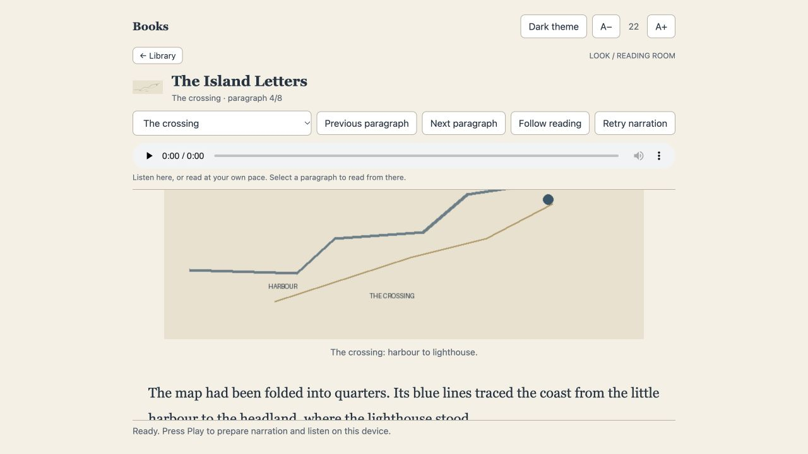

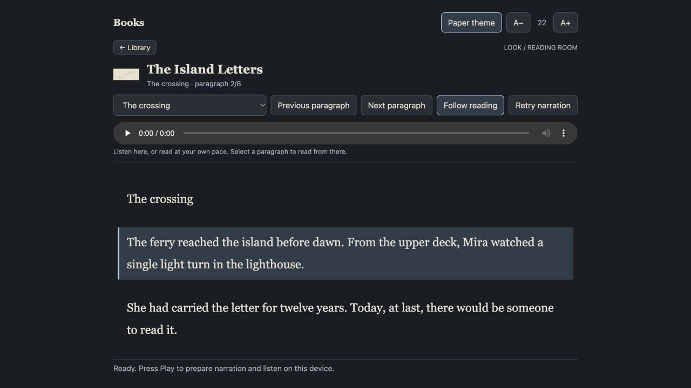

Screenshots use a fictional illustrated book and silent test narration.

## Narration controls in the browser

**Voice** lists installed voices on the book owner; **Default** uses that owner's
LOOK speech preference when the book is opened. A browser's explicit voice choice is remembered
per owner without changing another listener's choice. Changing voice restarts the
current paragraph and preserves whether playback was running or paused.

The **Speed** slider changes playback immediately from 0.5× to 2× and is remembered
with the reading appearance. It continues at that speed through paragraph and
chapter changes. Speed changes reuse the prepared narration instead of generating
another copy. Voice choices may differ between owners because their installed
local voices differ. The interface never downloads a voice automatically.

## Terminal read-along controls

The read-aloud view now wraps complete paragraphs and highlights the selected
paragraph. Up/Down selects a paragraph; Page Up/Down and Shift-Up/Down scroll the
text, including long paragraphs. Left/Right changes chapter; Home/End and
Shift-Left/Right go to the first/last paragraph. Enter reads, Space pauses/resumes,
s stops and q/Esc returns. Blue command keys and subdued labels wrap across the
footer, including **P clipboard** and **W shell pane**. Shelf cover images are
cleared before entering the reader.

**v** cycles unique installed voice IDs and wraps after the final voice. **V**
restores the automatic default (Jamie Premium when installed on macOS; otherwise
the existing local fallback preference). **- / +** changes speed by 0.1× within
0.5–2×. Voice/speed changes preserve pause state and restart the current paragraph
when already reading. The local preference is shared with native Bookokrat
narration. The default voice is chosen from discovered installed voices.

## Native Bookokrat read-along companion

LOOK no longer forces Bookokrat's Zen mode, so its normal control bar is visible.
**q** quits and **?** opens searchable Help. Space then z still selects Zen mode.

The optional [LOOK Bookokrat companion](https://github.com/WaltRudyJabsco/Bookokrat-LOOK)
adds narration directly to Bookokrat's own EPUB text view:

```sh
lk books reader native-install
lk books reader status
lk books reader bookokrat
```

Setup downloads a fixed, checksum-verified native package for Apple Silicon
macOS or x86-64 Linux. Installation is explicit, staged and verified; maintenance
waits for it. The companion is kept in a versioned private directory and selected
by LOOK. Its source, upstream AGPL license and package source commit are available
with each build. Standard PDF/SVG reading remains enabled.

| Native Bookokrat sequence | Action |
|---|---|
| Space then r | Start narration at the visible/focused paragraph, pause/resume |
| Space then R | Read from the current visual paragraph |
| Space then x | Stop narration |
| Space then v / V | Next voice / automatic default voice |
| Space then - / + | Slower / faster |
| q / ? | Quit / native Help |

These are normal configurable Bookokrat actions. Its own paragraph blocks are
highlighted across wrapped lines and followed through paragraphs and chapters.
Navigating chapters manually stops the prior narration. The current voice and
speed appear in the reader HUD. No sound process outside this reader is stopped.
Native narration supports EPUB; PDF reading remains available without narration.
Bookokrat's native visual bookmarks stay separate from LOOK's owner-held browser
speech bookmarks; this integration does not guess a paragraph mapping between
the two readers.

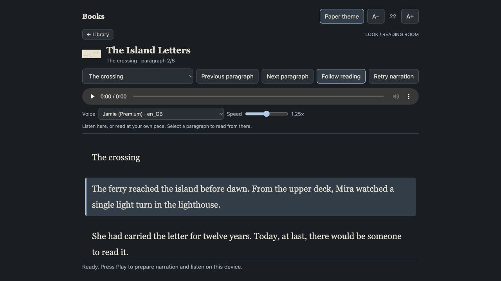

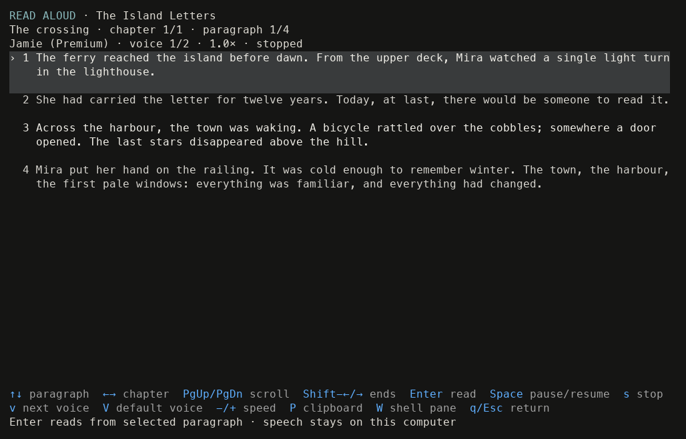

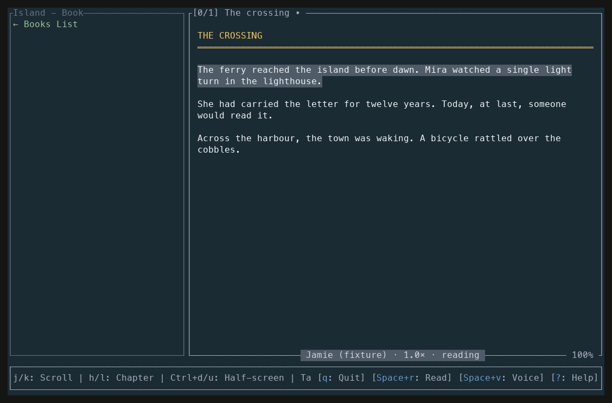

Terminal captures use fictional text and a silent fixture speech worker.

### Shelf search and Gutenberg discovery

The browser has separate **Search shelf** and **Search Gutenberg** buttons using
the same title/author field. Shelf search filters the list without opening a book.
**Discover Gutenberg** opens Popular; New arrivals, Subjects and Surprise me remain
available. **Load more books** retrieves the next official catalog page instead
of treating the first page as the whole category. Subjects use Gutenberg's field
query syntax; navigation entries are excluded from book results.

Sort the shelf by title (the default), author, last opened, or date added. The
browser remembers the sort choice. Last opened uses the saved reading timestamp;
books without reading history follow those with history.

Gutenberg results already on the reachable Fabric shelf are dimmed and labeled
**Already on your shelf · Read**. Selecting one opens the existing copy. Matching
uses Gutenberg record numbers from saved acquisition metadata or an explicit
Gutenberg EPUB identifier, never similar titles. Unreachable owners are reported;
LOOK cannot verify their holdings while offline. Downloads retain their original
Gutenberg identity across rescans, and repeated local acquisition of that record
returns the existing book without fetching it again.

### Standard British narrators

The web Voice selector puts **British male** and **British female** choices first
when those voices are installed on the book owner. `lk books voices --json` also
reports these platform choices in `standard`. They lead the terminal/native voice
cycle, with all other installed voices still available. Available Mac system voices are
used directly; Piper provides Alan and Alba for offline neural narration. The
explicitly labeled eSpeak male/female variants are basic fallbacks when present.
Existing voice preferences remain selected. **Default** continues to restore the
existing automatic/preferred narrator, rather than changing it during an upgrade.

Alba's [model card](https://huggingface.co/rhasspy/piper-voices/blob/main/en/en_GB/alba/medium/MODEL_CARD)
identifies the Edinburgh dataset and its CC BY 4.0 license. Voice capabilities
come from the book owner, so a browser on a Mac reading a 3090-owned book uses
the voices installed on the 3090.

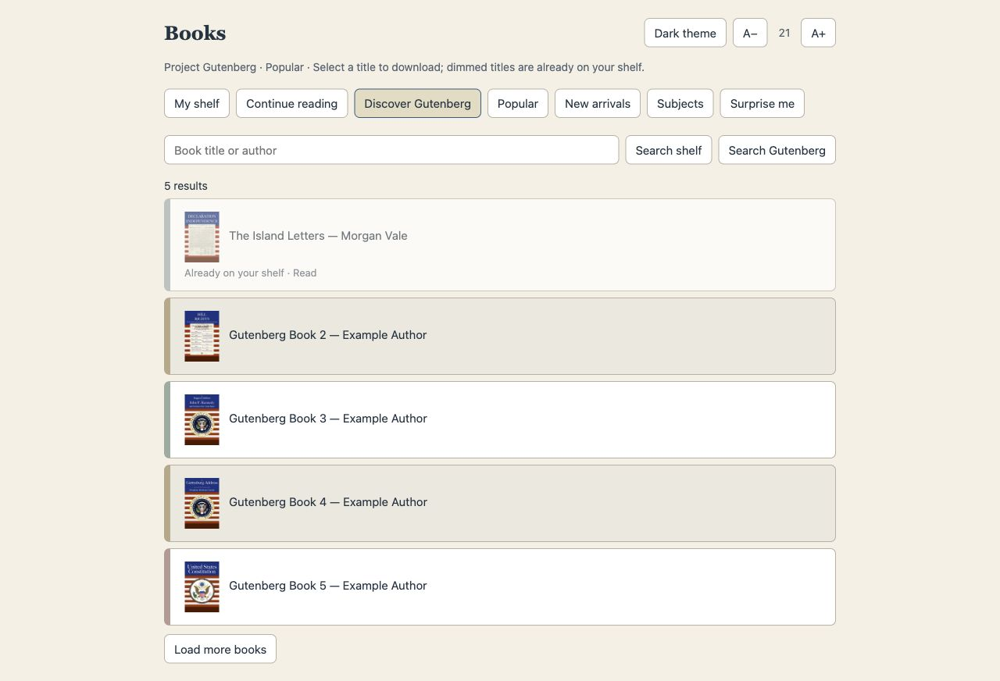

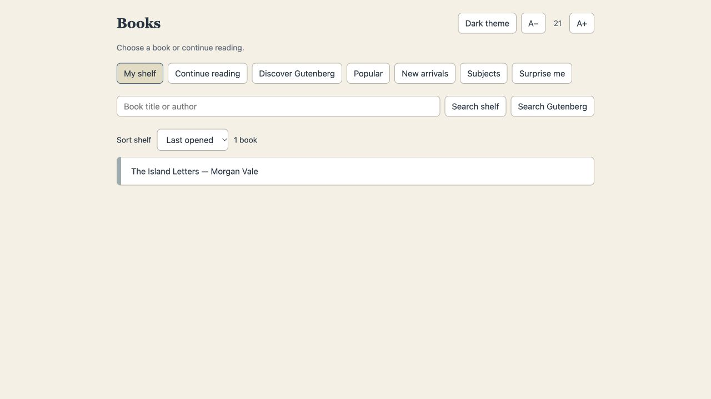

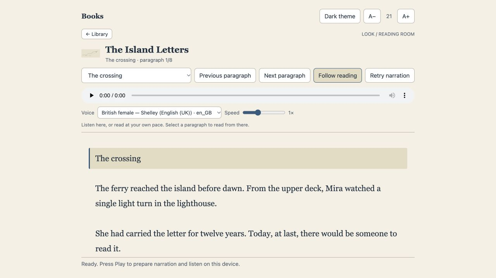

### Mercury Reader and next-paragraph preparation

The browser reading room is **Mercury Reader**, with Mercury Writer's serif
wordmark and gold accent. Open **Mercury Reader**, `/reader`, `/mercury-reader`,
or the existing `/books` command in Signal or Albert. `/reader` is the browser
page; existing `/books` bookmarks and query links continue to work. The terminal
command remains `lk books`.

During playback the browser prepares exactly one next paragraph: its reading
metadata and its complete narration file. At a chapter boundary it also prepares
the next chapter text. When that paragraph begins, the transport and highlighting
use the prepared data without another metadata request or speech-generation wait.
Speed changes reuse the same audio; changing voice, skipping elsewhere, opening
a different book, leaving for the shelf or closing the page cancels/discards stale
lookahead. A paused reader never starts playing because preparation completed.

Only the active clip and one next clip are retained in browser memory, with an
8 MiB limit on the next clip and object URLs released as clips are discarded. A
failed preparation falls back to the normal on-demand path. The book owner's
existing bounded audio cache can reuse previously generated passages. Very short
paragraphs, fast playback, or a slow book owner can still outpace preparation;
this reduces the generation gap rather than promising sample-accurate gapless
audio. A foreground seek briefly waits for already-running narration work instead
of immediately failing with a busy error. No new speech service or voice download
is needed.

Paragraph and chapter navigation preserve the current playing/paused state.

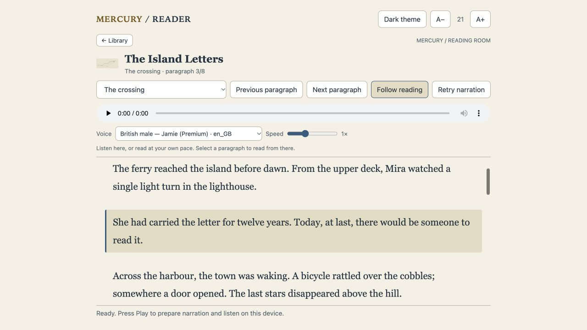

### Shelf covers and punctuation pauses

Mercury Reader shows a small, lazy-loaded cover beside each shelf title. Covers
come from the book's owner using embedded EPUB art or the existing PDF first-page
preview. Books without a supported cover show a consistent BOOK placeholder;
selecting the row still opens the book normally.

**Pauses** is separate from **Speed**. Choose **Voice default** for the engine's
original phrasing, **More space** (the new browser default) for extra breathing
room, or **Unhurried** for longer gaps. Speed still starts at 1× for a fresh
browser; your existing speed choice remains unchanged. Both settings are saved
locally. Changing pauses restarts the current paragraph and prepares subsequent
audio with the new setting, preserving playing/paused state.

The paced profiles target sentence endings, em dashes, spaced dashes, and colons;
word hyphens, numeric ranges, decimals, times, and common English abbreviations
are protected. This is punctuation-based phrasing, not a semantic language parser.
The source text and bookmarks are unchanged.

At 1×, More space requests 350 ms at sentence endings and 200 ms at clause breaks;
Unhurried requests 650 ms and 350 ms. Piper inserts frame-aligned silence while
loading its model only once per paragraph. Mac system voices use embedded silence
commands; eSpeak uses escaped SSML breaks. Actual engine timing varies, and browser
playback speed scales these pauses along with the spoken words. No new model or
package is required on a reader that already has its voice installed.

The [Piper synthesis API](https://github.com/OHF-Voice/piper1-gpl/blob/main/src/piper/voice.py)
provides the audio chunks used for this local composition. Pause profiles are
part of the audio cache identity, so prepared audio from a different setting is
discarded rather than played with the wrong pacing.

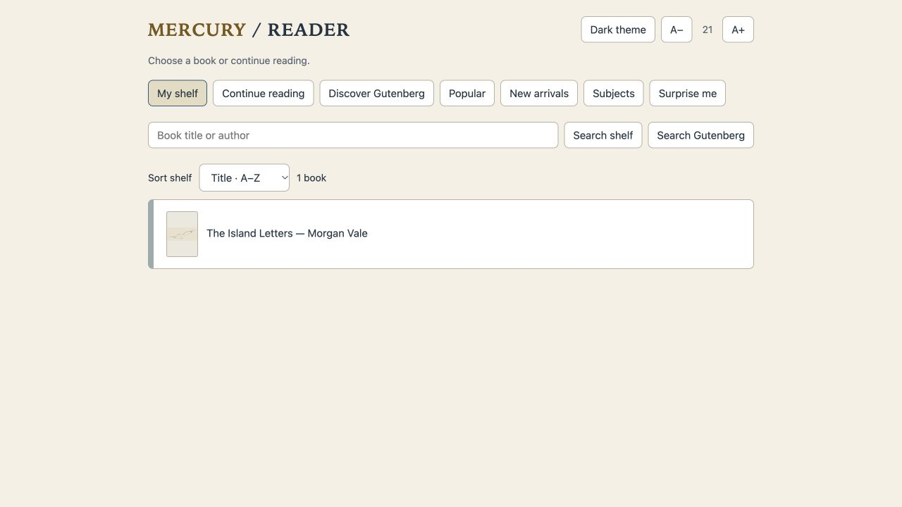

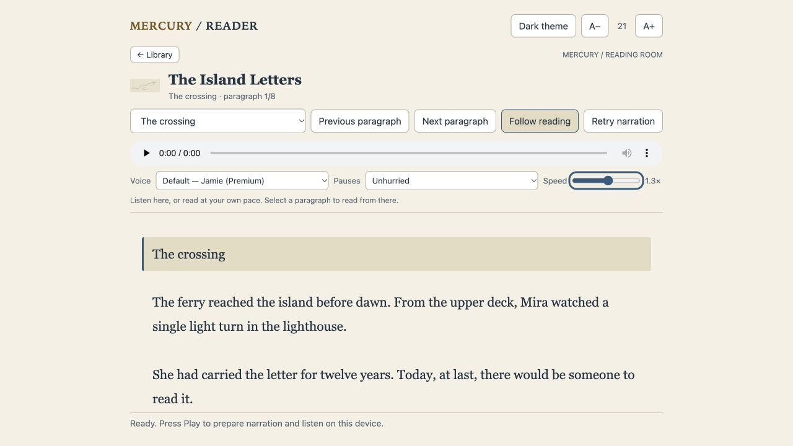
